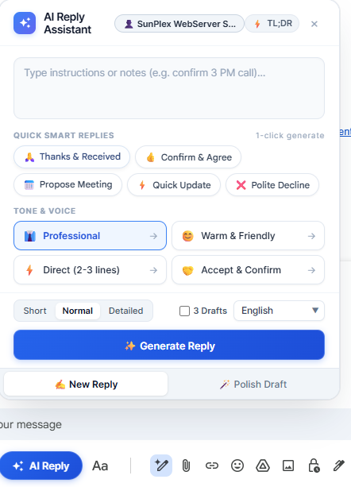

# 🚀 Gmail AI Reply Assistant

<p align="center">
  
</p>

<p align="center">
  <b>A state-of-the-art, lightning-fast Chrome Extension (Manifest V3) that crafts intelligent, context-aware email replies directly inside Gmail and Google Chat.</b>
</p>

<p align="center">
  <a href="https://github.com/rayhanvision-a11y/gmail-ai-reply-assistant/releases"></a>
  
  
  
  
</p>

---

## 🌟 Highlights & Key Features

### 🤖 1. Multi-Provider AI Architecture
Choose and switch between your favorite AI models anytime from the settings popup:
- **Google Gemini:** Gemini 1.5 / 2.0 Flash *(blazing-fast speed, generous free tier)*.
- **OpenAI (ChatGPT):** `gpt-4o-mini` and `gpt-4o` for unparalleled reasoning.
- **Anthropic (Claude):** `claude-3-5-haiku` and `claude-3-5-sonnet` for eloquent, natural business writing.
- **OpenRouter:** Access free community models (`Llama 3.3 70B`, `DeepSeek V3`, `Qwen 2.5`).
- **Chrome Built-in AI (Gemini Nano):** Zero key, zero cost, completely on-device offline processing.

### ⚡ 2. 1-Click Quick Smart Reply Chips
The assistant intelligently analyzes incoming emails and generates instant intent chips:
- `🙏 Thanks & Received`
- `👍 Confirm & Agree`
- `📅 Propose Meeting`
- `⚡ Quick Update`
- `❌ Polite Decline`
Click any chip to generate a full, contextually accurate reply in seconds.

### 🎭 3. Dynamic Tone & Voice Controls
Adapt the tone of your message to any business situation:
- 👔 **Professional:** Corporate, respectful, and authoritative.
- 😊 **Warm & Friendly:** Courteous, welcoming, and approachable.
- ⚡ **Direct (2-3 lines):** Concise, to-the-point answers for busy recipients.
- 🤝 **Accept & Confirm:** Clear approval with next steps.

### 📏 4. Length Controller & Multi-Draft Options
- **Short (2-3 lines):** Brief, efficient responses.
- **Normal:** Standard 1-2 paragraph professional emails.
- **Detailed:** Comprehensive, multi-point breakdowns.
- **Draft Generator:** Toggle between single or multiple drafts with one click.

### 🪄 5. Polish Draft / Rewrite Mode
Already typed a rough note or hurried draft? Switch to the **"Polish Draft"** tab to:
- Transform broken shorthand notes into polished executive prose.
- Fix grammar, syntax, spelling, and corporate etiquette instantly.
- Shorten lengthy emails without losing essential details.

### 🔄 6. Built-in In-Extension Update & Sync
No need to run manual Git commands or dig through settings:
- Open the extension popup and click **"🔄 Sync Now"**.
- Automatically checks GitHub for new releases.
- Download the latest update ZIP or reload the extension in 1-click directly from the popup UI.

### 🔒 7. Privacy First by Design
- **Direct API Connections:** Your browser connects directly to official Google, OpenAI, and Anthropic APIs.
- **No Middleman Servers:** No telemetry tracking, no analytics, and no remote databases.
- **Secure Local Storage:** API keys remain strictly stored inside your browser's encrypted local storage (`chrome.storage.local`).

---

## 📥 Installation Guide

### Method 1: Git Clone (Recommended for 1-Click Sync) ⭐

Cloning via Git allows you to receive instant updates with zero friction:

1. **Clone the repository:**
   ```bash
   git clone https://github.com/rayhanvision-a11y/gmail-ai-reply-assistant.git
   ```

2. **Load into Google Chrome:**
   - Navigate to `chrome://extensions` in your Chrome address bar.
   - Toggle on **"Developer mode"** in the top-right corner.
   - Click **"Load unpacked"** in the top-left corner.
   - Select the cloned `gmail-ai-reply-assistant` folder.

> 🔄 **How to update in the future:**
> When updates are released on GitHub, simply open the extension popup and click **"🔄 Sync Now"** (or run `git pull` in the folder), then hit **"Reload Extension"**.

---

### Method 2: Direct ZIP Download (GitHub Releases)

If you do not use Git, download the pre-packaged archive directly:

1. **Download:**
   - Download the latest release ZIP from the **[GitHub Releases Page](https://github.com/rayhanvision-a11y/gmail-ai-reply-assistant/releases)**.
   - Or download directly: **[Latest Source Code ZIP](https://github.com/rayhanvision-a11y/gmail-ai-reply-assistant/archive/refs/heads/main.zip)**.

2. **Extract:**
   - Unzip the downloaded `.zip` file into a permanent folder on your computer.

3. **Load into Chrome:**
   - Go to `chrome://extensions`.
   - Enable **"Developer mode"**.
   - Click **"Load unpacked"** and select the unzipped directory.

---

## ⚙️ Quickstart & Setup (Takes 30 Seconds)

1. Click the **puzzle icon (🧩)** in your Chrome toolbar and open **"Gmail AI Reply Assistant"**.
2. Select your preferred AI Engine (**Google Gemini**, **OpenAI**, or **Claude**).
3. Paste your API key:
   - **Google Gemini:** Free API key from [Google AI Studio](https://aistudio.google.com/app/apikey).
   - **OpenAI:** API key from [OpenAI Platform](https://platform.openai.com/api-keys).
   - **Anthropic:** API key from [Anthropic Console](https://console.anthropic.com/settings/keys).
4. Click **"⚡ Test Key"** to verify connection, then click **"Save Settings"**.
5. Open [Gmail](https://mail.google.com) and click **Reply** on any email.
6. Look at the compose bar next to the blue Send button—click **"✨ AI Reply"** to launch the assistant card!

---

## ⌨️ Keyboard Shortcuts

| Shortcut | Platform | Action |
| :--- | :--- | :--- |
| `Alt + Shift + R` | Windows / Linux | Toggle AI Reply Assistant on active compose |
| `Cmd + Shift + Y` | macOS | Toggle AI Reply Assistant on active compose |

---

## 🛠️ Project Structure

```
gmail-ai-reply-assistant/
├── assets/
│   └── preview.png             # UI screenshot preview
├── background/
│   └── service-worker.js       # Background AI API orchestrator
├── content/
│   ├── content.css             # Gmail compose floating UI styling
│   └── content.js              # DOM observer & contextual extraction
├── icons/
│   ├── icon-16.png
│   ├── icon-48.png
│   └── icon-128.png
├── popup/
│   ├── popup.html              # Multi-model settings & sync UI
│   ├── popup.css               # Modern executive popup styling
│   └── popup.js                # GitHub sync & API validation
├── manifest.json               # Manifest V3 extension configuration
├── LICENSE                     # MIT License
└── README.md                   # Documentation
```

---

## 📄 License

This project is licensed under the [MIT License](LICENSE) — free for personal and commercial use.

---

<p align="center">
  Made with ❤️ by <a href="https://github.com/rayhanvision-a11y">Rayhan Vision</a>
</p>
